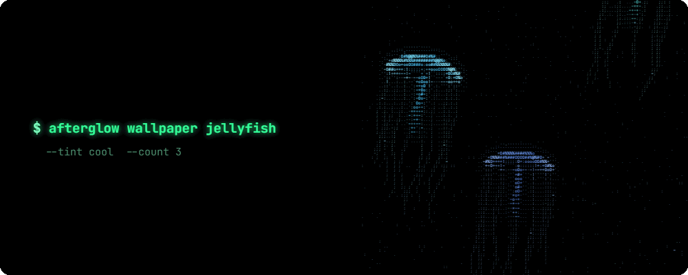

<p align="center">
  
</p>

<p align="center">
  <a href="https://github.com/wajenaqv/afterglow/actions/workflows/build.yml"></a>
  
  
  <a href="LICENSE"></a>
</p>

<p align="center">
  <b><a href="#-download">Download</a></b> ·
  <a href="#-what-it-does">What it does</a> ·
  <a href="#-how-it-works">How it works</a> ·
  <a href="#-roadmap">Roadmap</a> ·
  <a href="#-build-from-source">Build</a>
</p>

<br>

### Your desktop, quietly aware.

**AfterGlow** gives you living text-art wallpapers, drawn entirely in glowing characters.

Then your apps nudge them.

- A message arrives → the wallpaper lights up in that app's colour, then slowly fades. *That's the afterglow.*
- Things pile up → the scene fills up with them.
- You start a game → it pauses and uses nothing.

No popups. No badges. No sounds.<br>
You just ***see*** that something is waiting.

<p align="center">
  
</p>

## ✦ What it does

| when… | your wallpaper… |
| --- | --- |
| a WhatsApp message arrives | lights up in WhatsApp green, then fades |
| Slack, Teams or Discord pings you | lights up in that app's colour |
| your inbox fills up | gets busier, the more that's waiting |
| the song changes on Spotify | lights up in Spotify green |
| Do Not Disturb is on (Windows) | stays calm: no pulses, no flashes |
| a game or video goes fullscreen | pauses. Zero CPU while you play |
| windows cover it | that monitor pauses until you see it again |

You decide what each app does in **Settings → apps**: light up, flash or nothing, in its own colour or one you pick.

**Wallpapers today:** jellyfish, one big jellyfish, and glowing paw prints, each with its own palettes. More are on the way.

> [!TIP]
> Early days: see the [roadmap](#-roadmap) for what works today.

## ↓ Download

**Windows**: download `AfterGlow_<version>_x64-setup.exe` from the [latest release](https://github.com/wajenaqv/afterglow/releases/latest) and run it. It installs just for you, no admin needed.

> [!NOTE]
> The installer isn't code-signed (AfterGlow is a hobby project), so Windows may say *"Windows protected your PC"*. Click **More info → Run anyway**.

**macOS** (Apple Silicon and Intel): paste this into Terminal. It installs or updates AfterGlow in Applications and opens it ([read the script](install.sh)).

```sh
curl -fsSL https://raw.githubusercontent.com/wajenaqv/afterglow/main/install.sh | sh
```

Or download `AfterGlow_<version>_universal.dmg` from the [latest release](https://github.com/wajenaqv/afterglow/releases/latest). It isn't notarized by Apple, so the first time open **System Settings → Privacy & Security** and click **Open Anyway**. For Dock badges, allow AfterGlow under **Privacy & Security → Accessibility**.

> [!IMPORTANT]
> Quit any other live wallpaper app (Wallpaper Engine, Lively, Plash) first, or it will cover AfterGlow.

## ◉ How it works

```text
  your apps                 AfterGlow                   your wallpaper
 ───────────           ──────────────────            ──────────────────
  notifications  ──►    app.new                ──►    lights up
  dock badges    ──►    app.unread  n=14       ──►    fills up
  gmail · spotify ──►   your rules per app     ──►    flashes, or stays calm
  your scripts   ──►    POST 127.0.0.1:47811/signal
```

- **Wallpapers.** On every monitor, with hover effects, drawn on the graphics card (under 1% of the CPU while you look at it). They pause for fullscreen apps, behind windows and on battery.
- **Two signals.** Every app boils down to *something just happened* (`new`) and *this many are waiting* (`unread`).
- **Reactions.** Each wallpaper shows them its own way, and your rules decide which app does what.
- **Apps.** Windows notifications (WhatsApp, Slack, Teams, Discord, …), macOS Dock badges, Gmail, Outlook, Spotify, and a local endpoint for anything else.

### Connect your apps

Switch them on in **Settings → apps**. Each one has a step-by-step guide right there, with links to the right pages and copy buttons for everything you paste.

- **Windows notifications**: Windows asks once to allow access.
- **Dock badges** (macOS): macOS asks once for Accessibility access.
- **Gmail, Outlook, Spotify**: AfterGlow has no server and no shared keys, so you register your own free app (2 to 5 minutes, once) and sign in.

### Send signals from your own scripts

While AfterGlow runs, it listens on your own computer only:

```sh
curl -X POST http://127.0.0.1:47811/signal -d '{"source":"build","kind":"new"}'
```

| field | |
| --- | --- |
| `source` | a name: `whatsapp`, `gmail`, `build`, … (known apps light up in their own colour) |
| `kind` | `new` (something happened), `unread` (how many are waiting, with `count`), `clear`, `flash` |
| `count` | for `unread` |
| `colour` | optional `#rrggbb` |
| `afterglow` | optional seconds the glow takes to fade (default 4) |

Requests from web pages are refused, so a website can't set your wallpaper off. To try it without writing anything, use **Try a signal** in the tray menu.

### Also in Settings

- **Rotation**: a different wallpaper every 5, 10, 30 or 60 minutes.
- **Save a still**: a PNG of any wallpaper at your screen's size, into Pictures/AfterGlow.
- **Performance**: frame rate, and graphics card or CPU.

## ⚿ Private by design

- Everything runs on your machine. There is no server and no telemetry.
- AfterGlow never reads message content, only *which app* and *how many*.
- Sign-in tokens stay in your OS keychain.

## ▤ Roadmap

- [x] Wallpapers behind the desktop on every monitor, on Windows and macOS, with hover effects
- [x] Jellyfish, big jellyfish and paw prints, with palettes, picked in Settings
- [x] GPU rendering: a visible wallpaper costs under 1% of the CPU
- [x] Pauses for fullscreen apps, on battery, and per monitor behind windows
- [x] Reactions, a signal simulator, and a local endpoint for your scripts
- [x] Windows notifications, macOS Dock badges, Gmail, Outlook, Spotify, Do Not Disturb
- [x] Rules per app, rotation, saving a still, setup guides in Settings
- [ ] The first release
- [ ] More wallpapers
- [ ] Easier installs (winget, a one-line Mac install) and in-app updates

## ⌘ Build from source

You need [Bun](https://bun.sh), [Rust](https://rustup.rs) (stable) and the [Tauri prerequisites](https://tauri.app/start/prerequisites/) for your OS (Windows: Microsoft C++ Build Tools and WebView2; macOS: Xcode Command Line Tools).

```sh
bun install
bun run tauri dev      # run with hot reload
bun run tauri build    # build an installer / app bundle
```

On a Mac, your own build isn't notarized: after copying it to Applications, run `xattr -dr com.apple.quarantine /Applications/AfterGlow.app` once, or macOS says it's damaged.

<br>

<p align="center">
  <sub>Wears the colours of <a href="https://heywajih.com">heywajih.com</a> · built with <a href="https://tauri.app">Tauri</a> · <a href="LICENSE">MIT</a></sub>
</p>
