<p align="center">
  
</p>

<p align="center">
  <a href="https://github.com/wajenaqv/afterglow/actions/workflows/build.yml"></a>
  
  
  <a href="LICENSE"></a>
</p>

<p align="center">
  <b><a href="#-download">Download</a></b> ·
  <a href="#-what-it-does">What it does</a> ·
  <a href="#-how-it-works">How it works</a> ·
  <a href="#-roadmap">Roadmap</a> ·
  <a href="#-build-from-source">Build</a>
</p>

<br>

Your desktop, quietly aware. **AfterGlow** puts glowing text-art wallpapers behind your desktop icons and lets your apps nudge them. A message arrives and a jellyfish pulses green, then slowly fades: an afterglow. No popups, no badges, no sounds. You just *see* that something is waiting.

<p align="center">
  
</p>

## ✦ What it does

| when… | your wallpaper… |
| --- | --- |
| a WhatsApp message arrives | the jellyfish pulses green, then fades |
| your inbox fills up | more jellies drift in, one for every few unread |
| Slack or Teams pings you | a pulse in that app's colour |
| a song is playing on Spotify | breathes along, tinted by the cover |
| Do Not Disturb is on | everything slows down and dims |
| you launch a fullscreen game | it pauses. Zero CPU while you play |

You decide which app does what: *when* `source` *does* `signal`, *the wallpaper does* `reaction` *in* `colour`.

> [!TIP]
> Early days: this is where AfterGlow is headed. See the [roadmap](#-roadmap) for what works today.

## ↓ Download

**Windows**: grab `AfterGlow_<version>_x64-setup.exe` from the [latest release](https://github.com/wajenaqv/afterglow/releases/latest) and run it. It installs just for you, no admin needed.

> [!NOTE]
> The installer isn't code-signed yet, so Windows may say *"Windows protected your PC"*. Click **More info → Run anyway**.

**macOS**: build from source for now ([below](#-build-from-source)). A signed download comes later.

## ◉ How it works

```text
  connectors              signal bus                 wallpaper
 ─────────────          ──────────────           ─────────────────
  notifications  ──►    app.new                ──►   pulse(#33ff99)
  dock badges    ──►    app.unread  n=14       ──►   count(14)
  gmail · spotify ──►   rules: source → reaction ──► flash, dim, breathe
  your scripts   ──►    POST localhost:<port>/signal
```

- **A wallpaper host.** One window per monitor, behind the desktop icons. It pauses for fullscreen apps and games, and on battery.
- **Two signals.** Every connector boils activity down to `app.new` (something just happened) and `app.unread(n)` (how much is waiting).
- **Reactions.** Each wallpaper says what it can do (`pulse`, `count`, `flash`, …) and you choose how signals map onto them.
- **Connectors.** Windows notifications (WhatsApp, Slack, Teams, Discord), macOS Dock badges, Gmail and Outlook, Spotify, Do Not Disturb, time of day, and a local endpoint for anything else: scripts, Home Assistant, CI.

## ⚿ Private by design

- Everything runs on your machine. There is no server and no telemetry.
- AfterGlow never reads message content, only *which app* and *how many*.
- Sign-in tokens stay in your OS keychain.

## ▤ Roadmap

- [x] App scaffold, CI on Windows and macOS, Windows installer releases
- [ ] Wallpaper host: behind the icons, every monitor, pause rules, hover effects
- [ ] The jellyfish, with reactions built in, and a signal simulator
- [ ] Windows notifications and macOS Dock badges (WhatsApp works)
- [ ] Gmail / Outlook, Spotify, Do Not Disturb
- [ ] Rule editor, more wallpapers, rotation
- [ ] Signed installers and a macOS download

## ⌘ Build from source

You need [Bun](https://bun.sh), [Rust](https://rustup.rs) (stable) and the [Tauri prerequisites](https://tauri.app/start/prerequisites/) for your OS (Windows: Microsoft C++ Build Tools and WebView2; macOS: Xcode Command Line Tools).

```sh
bun install
bun run tauri dev      # run with hot reload
bun run tauri build    # build an installer / app bundle
```

Connectors that need API keys read them from `.env`. Copy `.env.example` and fill in only the ones you use.

<br>

<p align="center">
  <sub>Wears the colours of <a href="https://heywajih.com">heywajih.com</a> · built with <a href="https://tauri.app">Tauri</a> · <a href="LICENSE">MIT</a></sub>
</p>
