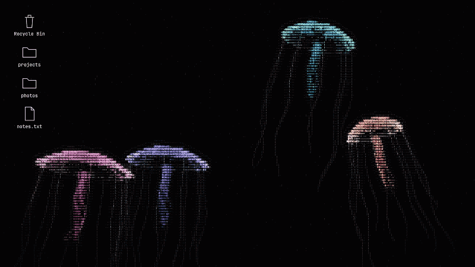
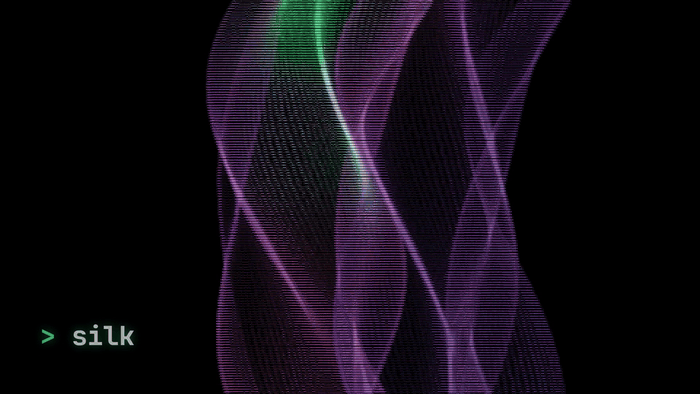

<p align="center"></p>

<p align="center">
  <a href="https://github.com/wajenaqv/afterglow/releases/latest"></a>
  
  
  <a href="LICENSE"></a>
</p>

<p align="center">
  <b><a href="https://afterglow.heywajih.com">Website</a></b> ·
  <a href="#-install">Install</a> ·
  <a href="#-what-it-does">What it does</a> ·
  <a href="#-how-it-works">How it works</a> ·
  <a href="#-make-it-yours">Make it yours</a> ·
  <a href="#-build-from-source">Build</a>
</p>

<br>

### Your desktop, quietly aware.

**AfterGlow** puts living text-art behind your desktop icons, drawn entirely in glowing characters.

Then your apps nudge it.

- A message arrives → it lights up in that app's colour, then slowly fades. *That's the afterglow.*
- Things pile up → the scene fills.
- You start a game → it pauses.

No popups. No badges. No sounds.<br>
You just ***see*** that something is waiting.

<p align="center">
  <a href="https://afterglow.heywajih.com"></a>
</p>

## ↓ Install

**macOS** (Apple Silicon and Intel): paste into Terminal

```sh
curl -fsSL https://raw.githubusercontent.com/wajenaqv/afterglow/main/install.sh | sh
```

**Windows**: paste into PowerShell

```powershell
irm https://raw.githubusercontent.com/wajenaqv/afterglow/main/install.ps1 | iex
```

Free, no admin needed. Run the same line again to update. Read [install.sh](install.sh) or [install.ps1](install.ps1) first if you like.

> [!IMPORTANT]
> Quit other live wallpaper apps (Wallpaper Engine, Lively, Plash) first, or they cover AfterGlow.

<details>
<summary>Download by hand instead</summary>
<br>

Get the `.dmg` or `.exe` from the [latest release](https://github.com/wajenaqv/afterglow/releases/latest). AfterGlow is a hobby project without paid signing, so both show a warning: on macOS use **System Settings → Privacy & Security → Open Anyway** (maybe twice), on Windows **More info → Run anyway**.

</details>

## ✦ What it does

| when… | your wallpaper… |
| --- | --- |
| a message arrives | lights up in that app's colour, then fades |
| something is still waiting | can keep a light on until you've seen it |
| your inbox fills up | gets busier, the more that's waiting |
| you were away | replays what you missed when you're back |
| Do Not Disturb is on (Windows) | stays calm |
| a game or video goes fullscreen | pauses |
| windows cover it, or you're on battery | pauses |

Each wallpaper reacts in its own way. Every app starts switched off; you choose what AfterGlow listens to in **Settings → apps**.

## ◉ How it works

```text
  your apps                 AfterGlow                   your wallpaper
 ───────────           ──────────────────            ──────────────────
  notifications  ──►    something new          ──►    lights up
  dock badges    ──►    14 waiting             ──►    fills up
  your accounts  ──►    your rules per app     ──►    flashes, or stays calm
  your scripts   ──►    POST 127.0.0.1:47811/signal
```

- **Two signals.** Every app boils down to *something just happened* and *this many are waiting*.
- **Your rules.** For each app: light up, flash or nothing, in its own colour or one you pick.
- **Light on your computer.** Drawn on the graphics card, with a CPU version when there isn't one.

## ⚙ Make it yours

<p align="center"></p>

- **Wallpapers** with their own palettes and options, and more on the way
- **Rotation**: a different one every 5, 10, 30 or 60 minutes
- **A clock** that fades in when you rest the cursor in a corner, or stays on
- **Stills**: save any wallpaper as a PNG at your screen's size
- **Frame rate** and rendering, to suit your machine

### Send your own signals

A build finished, the laundry's done, the doorbell rang:

```sh
curl -X POST http://127.0.0.1:47811/signal -d '{"source":"build","kind":"new"}'
```

AfterGlow listens on your own computer only, and refuses requests from web pages. [All the options](docs/signals.md).

## ⚿ Private by design

- No server, no account and no telemetry.
- AfterGlow keeps *which app* and *how many*, never what a message says.
- It only goes online for the accounts you connect yourself.
- Sign-in tokens stay in your OS keychain.

## ▤ Next

- [x] First release, with one-line installs
- [ ] More wallpapers
- [ ] winget and the Microsoft Store
- [ ] In-app updates

Ideas and bugs are welcome in [issues](https://github.com/wajenaqv/afterglow/issues).

## ⌘ Build from source

You need [Bun](https://bun.sh), [Rust](https://rustup.rs) (stable) and the [Tauri prerequisites](https://tauri.app/start/prerequisites/) for your system.

```sh
bun install
bun run tauri dev      # run with hot reload
bun run tauri build    # build an installer / app bundle
```

<br>

<p align="center">
  <sub>Wears the colours of <a href="https://heywajih.com">heywajih.com</a> · built with <a href="https://tauri.app">Tauri</a> · <a href="LICENSE">MIT</a></sub>
</p>
